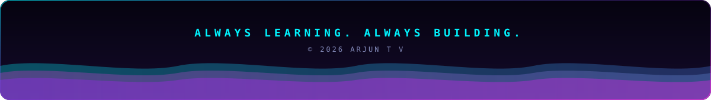

 

**Building practical software. Exploring intelligent systems. Designing modern web experiences.**

 

 

 

 

I'm a Computer Engineering student interested in software development, web technologies, automation, and AI-assisted applications. I enjoy turning ideas into useful projects and learning by building.

> **Portfolio →** [arjun-t-v.github.io/Arjun-portfolio](https://arjun-t-v.github.io/Arjun-portfolio/)

 

 

<table>
<tr>
<td align="center" width="170"><b><code>LANGUAGES</code></b></td>
<td>

</td>
</tr>
<tr>
<td align="center"><b><code>WEB &amp; BACKEND</code></b></td>
<td>

</td>
</tr>
<tr>
<td align="center"><b><code>DATA &amp; AI</code></b></td>
<td>

</td>
</tr>
<tr>
<td align="center"><b><code>TOOLS</code></b></td>
<td>

</td>
</tr>
</table>

 

 

<table>
<tr>
<td width="50%" valign="top">

#### ◈ PAPERLY
**Bloom's Taxonomy Question Paper Generator**

A question-generation application that applies NLP concepts and a desktop GUI to build question papers aligned with Bloom's Taxonomy.

[Details in Project Vault →](https://arjun-t-v.github.io/Arjun-portfolio/)

</td>
<td width="50%" valign="top">

#### ◈ RollNRent
**Bike Rental Platform**

A web-based bike rental management platform built on a classic PHP and MySQL stack.

[Details in Project Vault →](https://arjun-t-v.github.io/Arjun-portfolio/)

</td>
</tr>
<tr>
<td width="50%" valign="top">

#### ◈ Password Analyzer
**Password Strength Utility**

A Python application that evaluates password strength and estimates resistance to brute-force attacks.

[Details in Project Vault →](https://arjun-t-v.github.io/Arjun-portfolio/)

</td>
<td width="50%" valign="top">

#### ◈ PARKEASE
**Smart Parking Platform**

A parking-slot management project exploring IoT sensor integration and ML-based parking-duration prediction.

[Details in Project Vault →](https://arjun-t-v.github.io/Arjun-portfolio/)

</td>
</tr>
</table>

 

 

 

 

 

 

<table>
<tr>
<td align="center" width="25%" valign="top">

**`PROJECT VAULT`**

Selected projects and technical details

</td>
<td align="center" width="25%" valign="top">

**`RESUME`**

Education, skills, and project experience

</td>
<td align="center" width="25%" valign="top">

**`CERTIFICATE GALLERY`**

Certifications and workshops

</td>
<td align="center" width="25%" valign="top">

**`CONTACT`**

Ways to connect

</td>
</tr>
</table>

 

 

 

 

